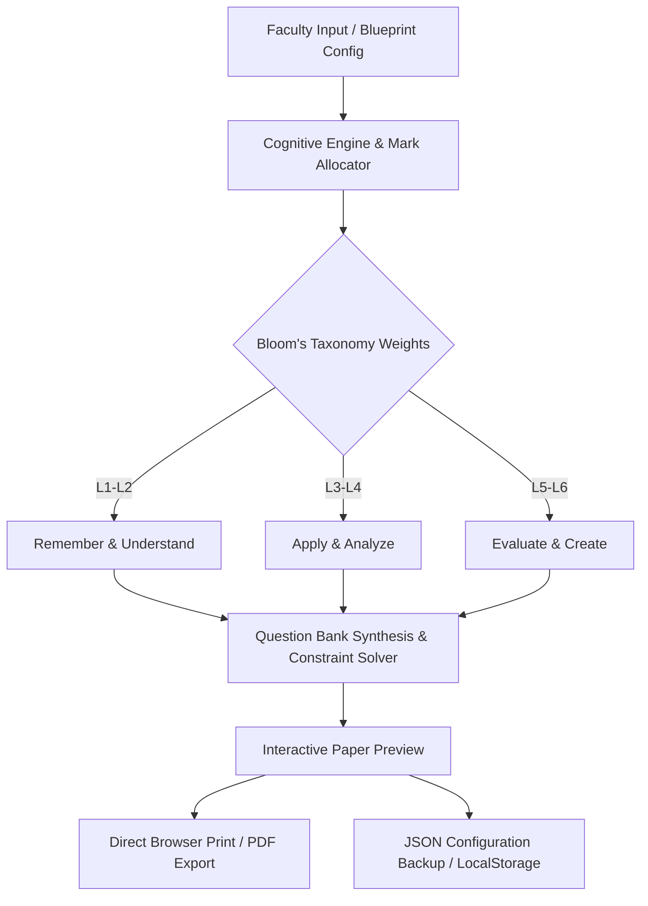

<div align="center">

# QuestGen: AI-Based Question Paper Generator

**An intelligent, browser-native examination synthesis engine aligned with Bloom's Revised Taxonomy.**

[](index.html)
[](package.json)
[](render.yaml)
[](LICENSE)

</div>

---

## 1. Executive Summary

**QuestGen** is a production-ready, client-side examination synthesis application engineered for university faculty, academic boards, and school administrators. It addresses the recurring challenge of creating balanced, academically rigorous question papers by enforcing **Bloom's Revised Taxonomy (Anderson & Krathwohl, 2001)** across marks, cognitive difficulty levels, and syllabus units.

Built with pure vanilla web standards (HTML5, Modern CSS3 Design Tokens, ES6+ JavaScript), QuestGen requires **zero server-side runtime, zero database overhead, and zero third-party build tooling**. It deploys instantly to any static hosting infrastructure (Render, GitHub Pages, Vercel, Cloudflare Pages) or runs offline in air-gapped institutional environments.

---

## 2. Key Architecture & Data Flow



### Cognitive Distribution Engine
QuestGen partitions assessments across three customizable structural sections:
- **Part A (Short Answer / Objective):** Focuses on Knowledge Retrieval (L1) and Conceptual Clarity (L2).
- **Part B (Analytical / Descriptive):** Focuses on Procedural Application (L3) and Analytical Decomposition (L4).
- **Part C (Comprehensive / Design / Evaluative):** Focuses on Complex Synthesis (L5) and Formulation/Creation (L6).

---

## 3. Core Capabilities

- **Automated Mark Balancing:** Dynamically calculates total marks, question weights, and section-level parity in real time.
- **Bloom's Taxonomy Alignment:** Every question is tagged with cognitive depth metrics (L1 through L6) to guarantee academic compliance.
- **Print-Optimized Typography:** Formatted with `Playfair Display` for institutional mastheads and `IBM Plex Sans / Mono` for clean, unambiguous mathematical and textual formatting. Includes custom `@media print` stylesheets that strip UI controls and produce camera-ready PDF examination papers.
- **Dual Synthesis Modes:**
  - *Template Engine:* Generates standardized Mid-Semester (30/50 marks) and End-Semester (100 marks) papers with configurable choice schemes (e.g., "Answer Any 5 of 7").
  - *Custom Course Blueprint:* Allows fine-grained definition of course codes, academic terms, instructions, course outcomes (COs), and program outcomes (POs).
- **100% Client-Side Privacy:** No student data, exam questions, or institutional rubrics ever leave the browser. Zero telemetry or external API dependencies.

---

## 4. Quickstart & Local Execution

QuestGen runs natively in any standard web browser without compilation, node modules, or environment configuration.

### Option A: Direct Browser Launch
Simply double-click `index.html` or open it from your file manager:
```bash
# Windows
start index.html

# macOS
open index.html

# Linux
xdg-open index.html
```

### Option B: Local HTTP Server (Optional)
If running inside a developer sandbox or local development server:
```bash
# Python 3
python -m http.server 8080

# Node.js
npx serve .
```
Navigate to `http://localhost:8080` in your web browser.

---

## 5. Deployment Guide (Render)

This repository includes a pre-configured Infrastructure-as-Code blueprint (`render.yaml`).

### Deploy via Render Blueprint
1. Fork or push this repository to your GitHub account.
2. Sign in to your [Render Dashboard](https://dashboard.render.com).
3. Click **New +** > **Blueprint**.
4. Connect this repository. Render automatically reads `render.yaml` and provisions a global **Static Site** with:
   - Security headers (`X-Frame-Options: SAMEORIGIN`, `X-Content-Type-Options: nosniff`)
   - HTTPS/SSL certificates managed automatically
   - Automatic preview deployments for pull requests

---

## 6. Repository Structure

```
AI-Based-Question-Paper-Generator/
├── .github/
│   └── workflows/
│       └── ci.yml             # Automated entrypoint & HTML integrity verification
├── index.html                 # Standardized single-page application entrypoint
├── question_paper_generator (1).html # Legacy entrypoint preserved for compatibility
├── render.yaml                # Render Static Site Infrastructure-as-Code blueprint
├── LICENSE                    # MIT open-source license
└── README.md                  # Comprehensive technical documentation
```

---

## 7. Security & Compliance Disclosure

- **Zero Network Transmission:** All question bank generation, state management, and PDF rendering execute strictly inside the browser runtime.
- **Local Persistence:** Data is retained within the browser's sandboxed `localStorage` and can be wiped instantly by clearing browser site data.
- **Air-Gap Certified:** Can be archived into a single offline directory and executed on disconnected institutional intranets with zero internet access.

---

## 8. Author & Attribution

**Purna Chandra Maharana**
- Portfolio: [github.com/purnachandra-maharana](https://github.com/purnachandra-maharana)
- Reference Standard: [Inkloom AI](https://github.com/purnachandra-maharana/inkloom-ai)
